# OpenDrumHero

**Practice electronic drums like a game — with any song.**

OpenDrumHero is for **people starting out on electronic drums** who want practice to feel like playing a game.
Bring the songs you want to learn — **imported from Songsterr or from your own Guitar Pro files** — and play
them with **Guitar Hero / Rocksmith mechanics**: the notes come to you on a **continuous 3D highway** or on an
**interactive drum score**, every hit is scored on the spot, and you can slow the song down and loop the hard parts
until they click.

## What you need

| | |
|---|---|
| 🥁 **Electronic drum kit** | any kit with a USB MIDI port |
| 🔌 **USB cable (USB-B ↔ USB-A)** | the kit's USB MIDI cable — sends your hits to the game (on a phone, add a USB OTG adapter) |
| 🎧 **3.5 mm audio cable** (P2) | sends the game's sound into the kit (*or* Bluetooth, if your kit receives audio by Bluetooth) |
| 💻📱 **A PC or a phone** | Windows PC or Android 13+ phone running OpenDrumHero |
| 🎧 **Headphones** | plugged into the kit |

## How it connects

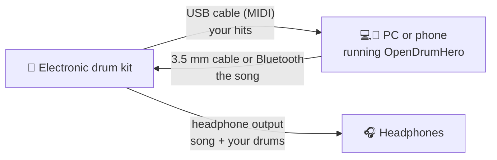

1. **Drum kit → USB cable (MIDI) → PC/phone:** the game receives every hit — this is what lets you play.
2. **PC/phone → 3.5 mm cable (kit's AUX IN) or Bluetooth → drum kit:** the song goes into the drum module.
3. **Drum kit → headphones:** you hear the song and your own drums together, mixed by the module.

> The cable has less delay than Bluetooth. Either way, run **Test audio delay** once (Settings → Audio) and the game
> lines everything up. No drum kit yet? You can try it on the PC keyboard or by tapping the phone screen.

## What it is

**Play real songs on your electronic drum kit, Rocksmith style.** Plug any USB MIDI drum kit into your
Windows PC or Android phone, import a song from a Guitar Pro file (or straight from Songsterr) and play it on a
3D note highway or on a scrolling drum score — with the original recording, karaoke lyrics and a practice mode.

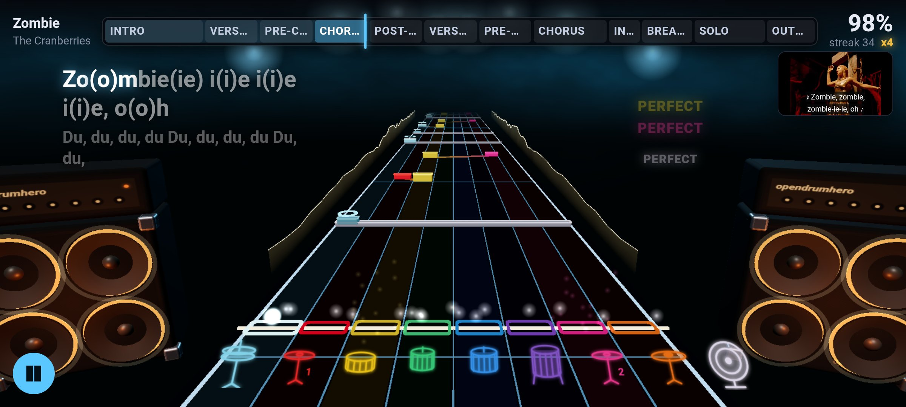

### At a glance

- 🥁 **Any USB MIDI drum kit**, on **Windows (exe)** and **Android 13+ (apk)** — map your pads in a minute with *Learn* mode. No kit? Play on the PC keyboard or by tapping the screen.
- 🎼 **Two views, switch any time:** a 3D highway (Guitar Hero/Rocksmith style) or a horizontal **drum score** with real notation.
- 🎵 **Import from Guitar Pro** files (.gp, .gp3–.gp8, .gpx) — or paste a **Songsterr** link (with your own Plus account) to get the chart, synced **YouTube audio** (original or *without drums*) and lyrics.
- 🎤 **Karaoke lyrics** synced to the music.
- 🔁 **Riff Repeater:** loop any stretch of the song, with automatic speed-up as you nail it; song speed from 25 % to 100 %.
- 📈 **Dynamic difficulty** (5 levels, per section) and detailed results: accuracy, perfect/great/good, early/late average.
- 🎯 **Audio calibration**, adjustable hit windows, open/half-open/closed hi-hat, ghost notes and accents.
- 🎨 Custom lane colors, graphics quality options, English and Portuguese.
- 🔒 Runs fully on your device — no account, no server, no tracking.

| Scrolling drum score — same game mechanics | Paused: speed, audio, difficulty, Riff Repeater |
|---|---|
| 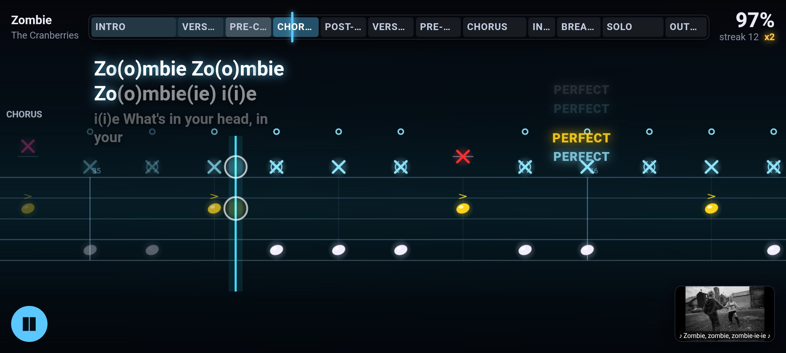 | 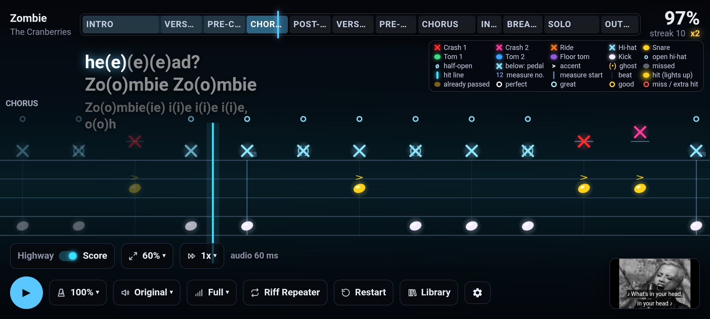 |

| Library — drum kit plugged straight into the phone |
|---|
| 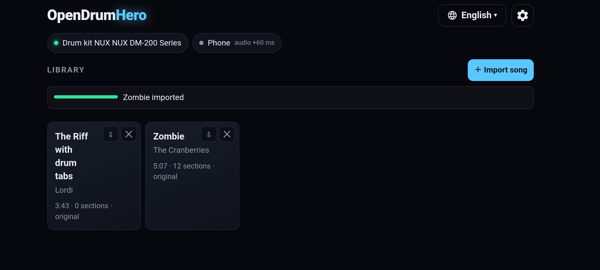 |

> **Status:** 1.0.0 — the Windows exe and the Android apk are not code-signed yet (see [Installing](#installing)).

---

## Contents

- [Installing](#installing)
- [First steps](#first-steps)
- [Importing songs](#importing-songs)
- [Playing](#playing)
- [Settings reference](#settings-reference)
- [Where your data lives](#where-your-data-lives)
- [Troubleshooting](#troubleshooting)
- [Building from source](#building-from-source)
- [How it works](#how-it-works)
- [Legal](#legal)

---

## Installing

Download the latest **`OpenDrumHero-<version>.exe`** (Windows) and/or **`OpenDrumHero.apk`** (Android) from the
project's releases.

### Windows (exe)

- A single portable file — no installer. Put it in a folder of its own (the app saves its `config/` and
  `library/` folders next to it) and open it.
- **SmartScreen warning:** the exe is not code-signed, so Windows may show *"Windows protected your PC"*.
  Click **More info → Run anyway**. You can check the file with your antivirus first.
- The game opens in your **default browser**. With a Chromium-based browser (Chrome, Edge, Brave, Vivaldi…)
  it gets its own window without an address bar; with others (Firefox…) it opens as a normal tab.
  The exe stays in the background and closes by itself when you close the game window.

### Android (apk)

- Android 13 or newer. Copy the apk to the phone and open it.
- The apk is not from the Play Store and is not signed with a release key: Android asks you to **allow installing
  from this source**, and **Play Protect** may warn that the app is unknown — choose *Install anyway*.
- Plug the drum kit with a **USB OTG cable/adapter**.

---

## First steps

1. **Connect everything** as in [How it connects](#how-it-connects). The library shows *Drum kit: connected* when it sees the kit.
2. **Map your pads:** ⚙ Settings → **Map drum kit**. Click **Learn** on a piece zone and hit the pad. The defaults
   follow General MIDI, which many kits use out of the box. Each piece can have several notes, and the same note can
   trigger more than one piece.

   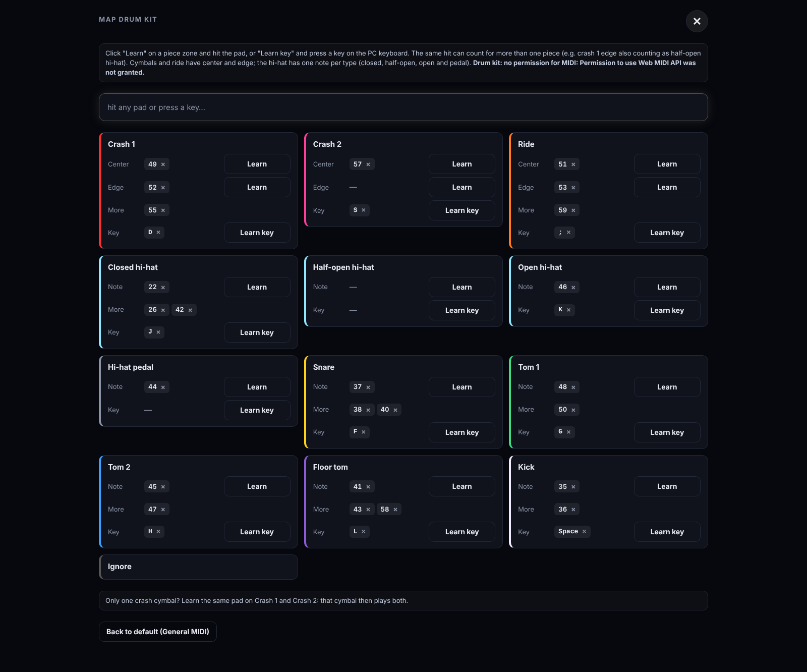

   *Only one crash cymbal?* Learn the same pad on **Crash 1** and **Crash 2**.
3. **Calibrate the audio:** ⚙ Settings → Audio → **Test audio delay**. Plug your headphones the way you'll play, hit
   any pad along with the clicks and use the measured value.
4. **Import a song** and play.

No drum kit? On the PC the keyboard plays (Space = kick, F = snare, J/K = hi-hat, G/H = toms, L = floor tom,
D/S = crashes, ; = ride — all remappable in *Map drum kit*). On the phone, tap the piece icons below the hit line.

---

## Importing songs

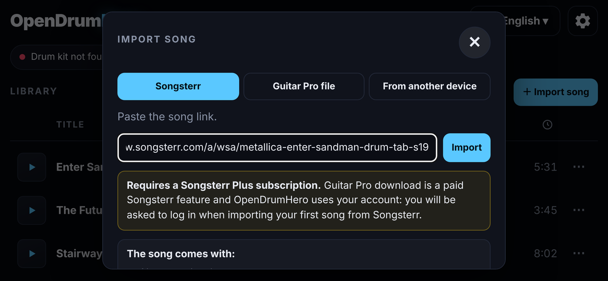

**Import song** in the library has three tabs:

| Tab | What you get |
|---|---|
| **Songsterr** (exe and apk) | Paste a song link. Needs a **Songsterr Plus** account: the app downloads the Guitar Pro file with *your* login (a login window appears the first time). You get the notes, synthetic audio, the **original recording and the recording without drums from YouTube** when Songsterr has a synced video, and lyrics when the tab has them. |
| **Guitar Pro file** | Any .gp / .gp3 / .gp4 / .gp5 / .gpx / .gp7 / .gp8 with a drum track. You get the notes, synthetic audio and lyrics (if the file has them). |
| **From another device** | A `.drumhero.json` file exported with the ⇩ button on a song card — move songs between the PC and the phone with everything they had. |

The **synthetic audio** is generated on the device from the score (alphaTab + a General MIDI SoundFont), so it is
always perfectly in sync with the notes.

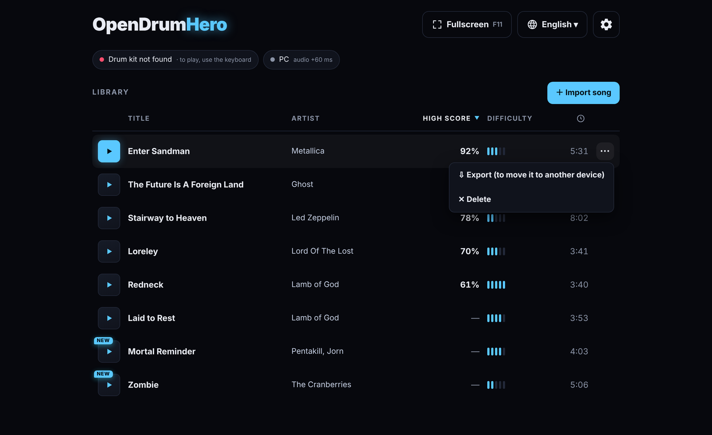

---

## Playing

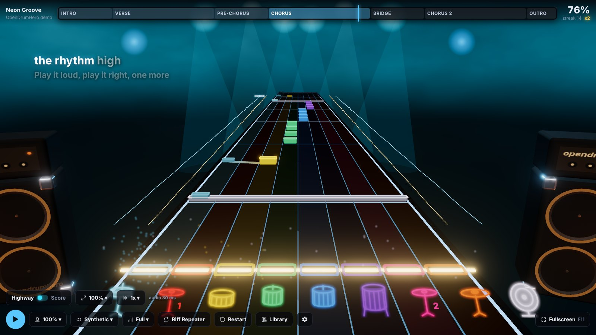

A song starts with a 4-3-2-1 count-in. While you play only the ⏸ button shows; pause to get the full bar:

| Control | What it does |
|---|---|
| **Highway / Score** | Switches the view instantly, even while playing. |
| **Note size** (↗) | 20 %–250 %, one value per view. |
| **Track speed** (⏩) | 0.25×–3.5× — how fast the notes scroll (not the music), one value per view. |
| **Song speed** (metronome) | 25 %–100 % in 5 % steps (the audio slows down with it). |
| **Audio source** | *Synthetic*, *Original* (YouTube) or *Original without drums* (YouTube). Your choice is remembered; if a song doesn't have it, Synthetic is used. |
| **Difficulty** | *Full*, *Dynamic* (goes up and down per section as you play) or levels 1–5. |
| **Riff Repeater** | Loops a range of sections, with a count-in before it and optional automatic speed-up (+5 % each time you reach 90 %). |
| **Restart / Library / ⚙** | Start over, go back, open the settings window. |
| **Fullscreen** (PC) | Also in the library. F11 works too. |

- **Sections bar** at the top: click anywhere to jump there (like a video timeline).
- **Scoreboard**: accuracy, streak and multiplier. Hits show *perfect / great / good*, and *early / late* when you're off.
- **Results** at the end: accuracy, best score, perfect/great/good/miss/extra counts, best streak and your
  average timing (early or late, and the spread) — useful to fine-tune the audio delay.
- **YouTube modes** show the video (small, top right on the highway, bottom right on the score).

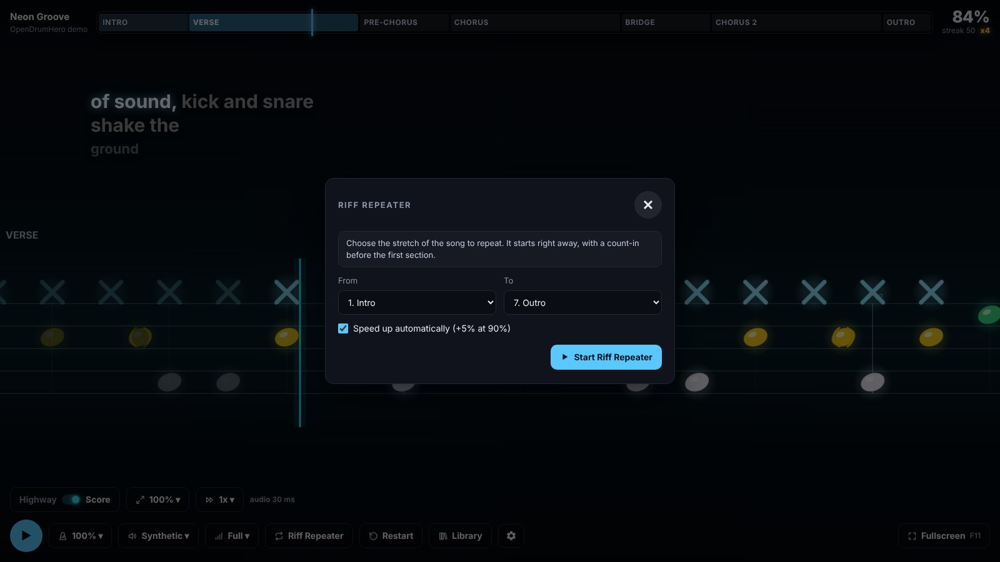

---

## Settings reference

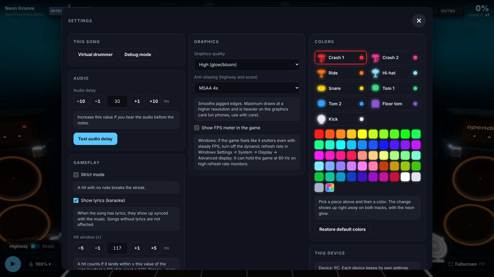

Open from the library (⚙) or from the pause bar. Each device keeps its own settings.

**This song** (inside a song)
- **Track** — which drum track to play, when the file has more than one.
- **Show video** — YouTube modes only.
- **Virtual drummer** — the computer plays the song (to watch or test).
- **Debug mode** — records the session (hits, timing) to a file, to report timing problems.

**Audio**
- **Audio delay** — compensates the time between the sound leaving the device and reaching your ears.
  **Test audio delay** measures it.

**Gameplay**
- **Strict mode** — a hit with no note breaks the streak.
- **Show lyrics (karaoke)** — on by default.
- **Hit window (±)** — how far from the note a hit still counts (perfect = ⅓ of it, great = ⅔). Default 117 ms.
- **Simultaneous (between notes)** — notes that must be played together only count if your hits are this close.
- **Priority to the early note** — when two notes compete for a hit.

**Graphics**
- **Graphics quality** — *High* (glow/bloom) or *Low* (lighter).
- **Anti-aliasing** — *Off*, *MSAA 4×* or *Maximum* (MSAA + supersampling).
- **Show FPS meter** in the game.

**Colors** — pick a piece and a color for both views (vivid palette or custom), or restore the defaults.

**This device** — phone or PC profile, drum kit status and **Map drum kit** (pads and PC keys).

**Language** — English or Portuguese, in the library.

---

## Where your data lives

| | Windows (exe) | Android (apk) |
|---|---|---|
| Library | `library/` next to the exe (one folder per song: `song.json`, `source.gp`, `source.mid`) | inside the app |
| Settings | `config/settings.json` next to the exe | inside the app |

- On Windows the browser only keeps a copy: switching the default browser or clearing its data loses nothing.
  If the exe's folder can't be written (e.g. *Program Files*), the data goes to `%APPDATA%\OpenDrumHero`.
  The environment variable `OPENDRUMHERO_DATA_DIR` chooses another folder.
- To move everything to another PC, copy `config/` and `library/` next to the exe there.
- Between PC and phone, use the ⇩ export button on each song.

---

## Troubleshooting

- **The game feels choppy even at a steady FPS (Windows).** Turn off *dynamic refresh rate* in Windows
  Settings → System → Display → Advanced display; it can hold the browser at 60 Hz on high refresh rate monitors.
- **Drum kit not found.** Use the kit's USB port (not the audio one), try another cable/port, and on Android an OTG
  adapter. Any *class compliant* USB MIDI kit works, on any MIDI channel.
- **Hits feel late or early.** Run *Test audio delay*; avoid Bluetooth headphones (they add 150–250 ms).
- **A YouTube video won't play.** Some videos can't be embedded outside YouTube; the game tries another synced video
  of the same type and then falls back to Synthetic.
- **Songsterr import on Android: "this browser or app may not be secure".** Google doesn't allow signing in with a
  Google account inside apps; sign in to Songsterr with e-mail/password (a notice explains it in the login screen).

---

## Building from source

Requirements: **Node.js LTS** (`winget install OpenJS.NodeJS.LTS`); for the apk, **Android Studio** (brings Java 21
and the Android SDK).

On Windows, double-click `shortcuts\Create shortcuts (double-click once).cmd` and use the shortcuts it creates:

- **OpenDrumHero - Build exe (Windows)** → `release\OpenDrumHero-<version>.exe`
- **OpenDrumHero - Build apk (Android) and install on connected phone** → `release\OpenDrumHero.apk`
  (also installs it if a phone is connected with USB debugging on)
- **OpenDrumHero - Test in browser** → development server with live reload

Or from a terminal: `scripts\setup.ps1`, `scripts\build-exe.ps1`, `scripts\build-apk.ps1`, `scripts\dev.ps1`.
Other systems: `cd frontend && npm install && npx ng build` (app), `npx ng test` (tests),
`npx cap sync android && cd android && ./gradlew assembleDebug` (apk); for Electron, copy `frontend/dist/frontend/browser`
to `desktop/app` and run `cd desktop && npm install && npm start`.

**Version:** `version.json` is the only place to change it (exe, apk and app get it at build time). Setting
`"autoBump": true` makes every build add 1 to the last number and to the Android build number.

---

## How it works

One Angular app (`frontend/`) is the whole game; the Windows exe and the Android apk are thin shells around it, so
every change applies to both.

```
frontend/            Angular + three.js app: game, library, chart building (alphaTab), texts (src/app/core/strings.ts)
frontend/android/    Capacitor project + native plugin: USB MIDI, file saving, Songsterr window
desktop/             Electron: local server for the app, /api (Songsterr import, library and settings files),
                     opens the game in the default browser
scripts/ shortcuts/  build scripts (PowerShell) and Windows shortcuts
config/ library/     created by the exe at run time (not in git)
```

- **Chart:** alphaTab reads the Guitar Pro file and renders its MIDI with repeats unrolled; the notes, sections,
  accents, ghost notes and hi-hat states come from the score in the same played order, so chart and audio match exactly.
- **Timing:** the game clock follows the audio (synthetic WAV or the YouTube player) and smooths corrections so the
  highway never jumps; hits are judged in real milliseconds whatever the song speed.
- **Why the browser on Windows:** YouTube refuses to play music videos inside Electron and on IP addresses, so the
  exe serves the game on `http://localhost` and opens it in your browser.

---

## Legal

- OpenDrumHero is released under the **MIT License** — see [`LICENSE`](LICENSE). Third-party components and their
  licenses (alphaTab — MPL-2.0, SONiVOX SoundFont — Apache-2.0, three.js, Angular, Capacitor, Electron…) are listed
  in [`THIRD_PARTY_NOTICES.md`](THIRD_PARTY_NOTICES.md), which also ships inside the exe and the apk.
- **Not affiliated** with Songsterr, YouTube/Google, Arobas Music (Guitar Pro), Activision (Guitar Hero),
  Ubisoft (Rocksmith) or any drum kit maker. Names are used only to describe compatibility.
- **Songsterr import** uses your own Songsterr Plus account to download what Songsterr offers you as a download. It
  automates the Songsterr website and may stop working if the site changes. You are responsible for using it in
  accordance with Songsterr's terms of service.
- **Songs are copyrighted.** Don't share imported songs or exported song files you don't have the rights to. Songs,
  lyrics and videos shown in the screenshots belong to their respective owners and appear only to illustrate the app;
  the demo songs further down were made for this project.
